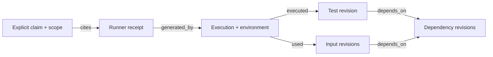

# Graph evaluation follow-up — 2026-10-20

The extraction-scoring correction materially changes the reported recall. The provenance prototype also exposes why a valid old receipt is insufficient to establish a current-state claim. This run is offline evaluation tooling: no hosted-model calls, new adjudications, live shadow activation, production-policy changes, commits or pushes.

Artifacts: `scratch/2026-10-20-claim-graphs/{manifest,extraction,provenance}.json`. The manifest records input and implementation hashes before scoring. The old artifacts remain intact. This is a retrospective rescore on reused model references, not another evaluation of the frozen judgment holdout.

## One-to-one extraction matching

`claim-matching.mts` implements maximum-weight bipartite matching using rectangular Hungarian assignment with explicit unmatched options. Weights are source-character intersection-over-union (IoU) over the reference core **and its qualifiers**. Each prediction and reference can participate in at most one pair. The primary threshold is 0.5; 0.25 and 0.75 are reported as sensitivity checks, not selected after looking at results.

Character positions are UTF-16 offsets; whitespace and Markdown formatting characters are excluded consistently with the old scorer. Multiple spans are unioned. Complete retention additionally requires every core and qualifier character in the assigned prediction; an overlap match alone does not count as complete retention. Matching precision and complete-retention precision count unmatched and duplicate predictions in the denominator.

| Extractor | Predictions | Old containment, complete claims | One-to-one complete claims, IoU ≥0.5 | Matched claims, including incomplete |
| --- | ---: | ---: | ---: | ---: |
| Legacy splitter | 363 | 426/666 (64.0%) | 204/666 (30.6%) | 248/666 (37.2%) |
| Span-preserving splitter | 699 | 594/666 (89.2%) | 371/666 (55.7%) | 436/666 (65.5%) |
| Saved Clairic outputs | 677 | 24/666 (3.6%) | 21/666 (3.2%) | 98/666 (14.7%) |
| Entire message as one candidate | 50 | 666/666 (100%) | 1/666 (0.15%) | 1/666 (0.15%) |

The old figures measure whether text survives somewhere in a candidate. They are useful retention diagnostics, but they overstate separately extracted claims because one broad candidate can receive credit for several references. The new numbers impose both a one-to-one requirement and an overlap threshold; their difference from the old numbers must not be attributed to assignment alone.

Under the new rule the span-preserving splitter still improves complete recall by 25.1 percentage points. Its complete-claim precision is 371/699 (53.1%), versus 204/363 (56.2%) for the legacy splitter. Qualifier attachment is 95/192 (49.5%) versus 61/192 (31.8%). These are agreement with model references, not semantic accuracy or evidential support.

| IoU threshold | Legacy complete claims | Span-preserving complete claims | Clairic complete claims | Whole-message control |
| --- | ---: | ---: | ---: | ---: |
| 0.25 | 249 | 418 | 22 | 15 |
| 0.50, primary | 204 | 371 | 21 | 1 |
| 0.75 | 152 | 308 | 19 | 0 |

The ordering survives the reported thresholds. Absolute recall depends on boundary and claim-unit conventions. Some unmatched predictions may be valid claims missing from the reference; others are nonclaims, fragments, duplicates or compound passages. The matching algorithm does not decide which. No reference labels were changed.

`extraction-comparison.mts` and `external-extractors.mts` now emit matching metrics as primary and retain old containment fields for historical comparisons. `graph-replay.mts` rescores the saved Clairic candidates without API access.

## Provenance prototype and actual-receipt replay

`provenance-graph.mts` stores claims, receipts, executions and file revisions with typed `cites`, `generated_by`, `executed`, `used` and `depends_on` edges. Observed and inferred edges remain distinct. The query targets the narrow explicit test-count grammar and an explicitly supplied test selection; it does not infer what a vague “tests pass” means.

The query checks receipt identity, completed execution, exact selection, captured dependency closure including configuration dependencies, stable inputs during execution, current hashes, and environment/selection identities. Missing capture, inferred-only links, ambiguous citations and nondeterministic reuse remain not assessable. A changed known input makes current-state support stale, not proof that a historical test run failed. Exact byte reverts are reusable only within the prototype's complete-input and deterministic-environment assumptions.

The saved `typed-receipt-01` has a real passing runner result and seven before/after file snapshots. It does **not** record a complete observed runtime input closure, environment identity, test-discovery identity or continuous input stability. The replay therefore returns `not_assessable / run_inputs_missing`. Two of the seven known inputs now differ: `claim-evidence.test.ts` and `claim-evidence.ts`. The result does not erase the historical pass or imply no test ran; it declines to turn it into current-state support.

The graph is not a producer-authentication boundary. Its “observed” and “complete” attributes require trusted capture adapters. An assistant can write a summary to a file and have a tool read it back; ending a path at a tool result does not make that content runner evidence. Receipt producers and content lineage still need validation outside this prototype.

Construction tests cover exact scope, changed dependencies/configuration, reverts, unrelated edits, incomplete closure, inferred links, assistant receipts, execution races, environment gaps, nondeterministic reuse, cycles, ambiguous citations and failing runners. These validate query behavior under explicit assumptions, not live capture completeness.

## Where graph technology fits

| Application | Concrete graph operation | Prerequisite / limitation |
| --- | --- | --- |
| Evidence freshness and scope | Typed path validation plus input-closure invalidation | Trustworthy receipt producers, complete versioned inputs and explicit claim interpretation |
| Instructions and corrections | Scoped supersession relations and active-conflict queries | Supersession is a partial order, not necessarily one chain; graph storage does not resolve ambiguous authority |
| Documentation liveness | Reachability from known entry points | Dynamic registration and incomplete discovery remain unknown |
| Extraction scoring | One-to-one weighted assignment | An explicit claim-unit convention; matching is not semantic adjudication |
| Mutation selection | Prior-history neighborhoods, dependency features and operator features | Capture/build cost must be counted; no held-out kill outcomes in ranking features |
| Semantic code localization | Typed graph neighborhoods around a proposed anchor | Model localization remains unproven; diffusion and distance are ranking signals |

Interlinked CLI already has `src/harness/test-dependency-graph.ts` with dependency closure, opacity and nondeterminism, and `src/harness/project-graph-reachability.ts` with entry-point reachability. Build on these representations before introducing another graph store. This experiment uses local TypeScript and JSON. A future persistence layer can use ordinary node/edge tables; neither a dedicated graph database nor a remote Durable Object is necessary to test these queries.

W3C PROV's entities, activities, agents and derivation relations provide useful vocabulary for receipts and executions. They do not certify their truth. [PROV-DM](https://www.w3.org/TR/prov-dm/)

### Program graphs and mutation cautions

A code property graph combines syntax, control flow and program dependence. The repository's import graph is not already a full code property graph. Reaching a comparison from a literal requires correctly modeled dependencies; PageRank over an import graph would not establish that relationship. Any diffusion must preserve edge direction/type and be compared with graph-only and lexical baselines. Its weights are not calibrated probabilities of a correct edit. [Original CPG paper](https://www.ieee-security.org/TC/SP2014/papers/ModelingandDiscoveringVulnerabilitieswithCodePropertyGraphs.pdf)

Checked coverage uses a dynamic slice of executed statements influencing the oracle. Static reachability alone overapproximates possible influence; it is not measured checked coverage. Data and control dependencies, runtime instances and instrumentation costs matter. This is not a free TypeScript feature. [Checked coverage](https://onlinelibrary.wiley.com/doi/abs/10.1002/stvr.1497)

For observed kill sets K, nonempty K(B) ⊆ K(A) means B dynamically subsumes A under that test suite. Selecting tests that kill B also kills A; merely running B does not establish either kill. Critically, surviving mutants all have empty observed kill sets. Their common empty set cannot show they represent the same missing behavior. New witness tests or behavioral observations are needed to group surviving gaps. Subsumption can reduce redundancy among killed mutants; it cannot replace our model-adjudicated grouping of survivors. [Dynamic mutant subsumption](https://arxiv.org/html/1809.02435)

Assertion minimization is a set-cover formulation only once the detection sets are measured. A greedy cover is not guaranteed minimal, and ordinary fail-fast runs leave many assertions unobserved. Membership outside one selected cover does not authorize deleting an assertion: isolation, side effects and other faults still matter.

## Corrections to the interpretation of earlier experiments

- Astra's 0/656 passes the specified control rule, not a general absence-of-bias test. The 656 comprise 608 historical removed/summary-only cases and 48 typed negatives. Not every historical claim had a certified altered or truncated variant.
- Weak real-message agreement could come from claim granularity, instructions, extraction omissions, schema failures or semantic mistakes. It does not establish ambiguity as the sole cause. Opus omitted qualifier fields, so qualifier agreement was not measured.
- The mutation heuristic used fixed operator priorities, not historical operator training. One module and seed do not decide the value of a Jev-plus-heuristic model. Such an experiment needs separate development data and a fixed combination rule.
- Citation Choice's 7/32 is a result for the entire retrieval/citation/judgment pipeline. It does not isolate location selection or establish that token localization will fail.
- Clairic's tested schema performed poorly at complete-clause enumeration. One schema does not establish that tuning cannot help. Typed-field extraction from already identified claims remains untested.
- Git diffs supply observed edit locations, not proof that edits were correct or within scope. Commit messages written after the change leak information relative to a prospective task. Prefer pre-edit task/issue text, temporal splits, insertion anchors, none/multiple-site cases, and changed-span-size baselines. Probability mass and graph distance are advisory measures.
- The choice limit concerns options, not the function's input-token count. A small task can need multiple sites or a missing insertion; a one-winner question must not erase those possibilities.
- The default-off receipt observer is an internal saved-transcript path, not a live hook. Live routing share and tail latency remain unmeasured. The Clef-flash comparison and hybrid mutation experiment were not run in this follow-up.

## Claim-unit convention for the next annotation revision

Freeze this convention before relabeling; preserve the current model references as version 1.

1. A claim unit is one independently assessable proposition with its subject, predicate, polarity, scope and time. “Typecheck passed and 11 tests passed” produces two units; “All 11 executed tests passed” stays one quantified proposition.
2. Keep qualifications, exceptions and negations with their parent proposition. Use multiple source spans and explicit relations when needed; do not enlarge a passage across unrelated assertions just to retain an exception.
3. Separate a statement that a source says X from the speaker's endorsement of X. Preserve speaker and authority; quoted material does not become a user instruction.
4. Keep plans, offers and questions separate from completed-action claims. A behavioral promise in documentation has a different source role from an agent's execution report.
5. A correction creates a new claim and a scoped supersession relation. Resolve only the fields and scope it explicitly changes. Incomparable instructions and ambiguous attachments remain unresolved.
6. Record ambiguity before support judgment. Missing interpretation, missing evidence, contrary evidence and extraction failure remain distinct. Matching source spans cannot settle these categories.

## Validation and scope

All **70 evaluation tests pass**, including 11 new graph/matching/replay tests. The evaluation TypeScript check passes. A scoped Gitleaks scan found no leaks, and `git diff --check` passed. The matching algorithm is also checked against exhaustive optima on small rectangular graphs.

This run did not test a new production integration. The existing repository-wide hook-coverage backlog is separate; a local verification job was started on 6,861 pending versions and has no completed verdict in this report. Its private job identity is retained with the local run artifacts.

Skill-impact review: this follow-up changes evaluation tooling and its metric definitions only. It introduces no CLI, configuration, hook, policy or operator contract, so no additional skill changes are required. Earlier source-skill edits for the default-off observer remain intact. New hosted-model API spend: **$0**; this does not assert that the assistant session itself is free.
